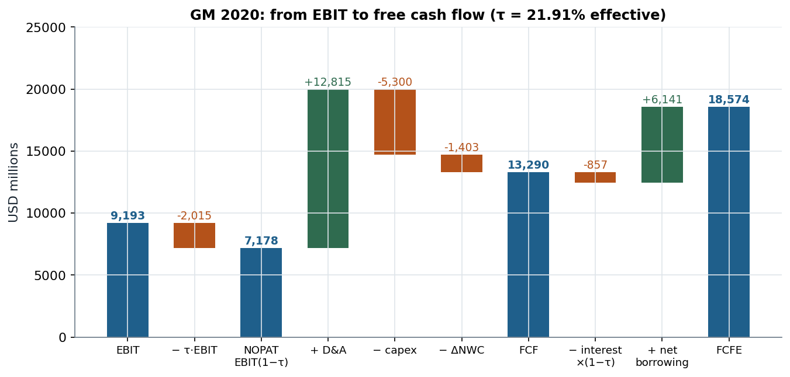

# 1.8 · Profits are not cash: the cash-flow statement, FCF and FCFE

> **Claim.** The cash-flow statement undoes the income statement's allocations. It adds back
> non-cash charges, nets out working-capital build-ups, and brings in capex and financing.
> **Free cash flow** is the cash the **assets** release after all investment, measured as if the firm
> were all-equity: $FCF=EBIT(1-\tau)+\text{Dep}-\text{Capex}-\Delta NWC$. It values the **business**
> (EV). **FCFE** subtracts after-tax interest and adds net borrowing; it values the **equity**. With
> taxes the two claims together receive $FCF+\tau\cdot\text{Int}$, not $FCF$. The gap is the tax
> shield, which later topics put in the discount rate (WACC) or price separately (APV).

Prev: [[L01-05-ratios-dupont-roic]] · Next: [[L01-07-formulas]] · Map: [[L01-00-map]]

**Notation.**

| Symbol | Meaning | Range |
|---|---|---|
| $\text{NI}$, $\mathrm{EBIT}$ | net income, earnings before interest and taxes | real |
| $\text{Dep}$ | depreciation and amortization of the period | $\ge0$ |
| $\Delta AR,\Delta AP,\Delta\text{Inv}$ | increases in receivables, payables, inventories | real |
| $\Delta NWC$ | working-capital investment: increase in operating current assets minus increase in non-interest-bearing current liabilities | real |
| $\text{Capex}$ | capital expenditures (purchases of PP&E) | $\ge0$ |
| $\text{Int}$, $\tau$ | interest expense; tax rate on pre-tax income | $\ge0$; $[0,1)$ |
| $\Delta D$ | net borrowing: debt issued minus debt repaid | real |
| $\text{Div}$, $\Delta PIC$ | dividends (and repurchases); new paid-in capital | $\ge0$; real |
| $FCF$, $FCFE$, $CF_D$ | free cash flow to the firm, to equity, cash flow to debtholders | real |

---

## 1 · C — why profits are not cash (slides 52–53)

Net income does not measure the cash the firm generated (slide 52):

1. it contains **non-cash entries** (depreciation, amortization);
2. it **omits** some cash outlays (capital expenditures, spending on inventory).

So "it is possible that a profitable firm has not enough cash to meet its obligations". The
statement of cash flows reports how much cash the firm generated and where it went, period by
period, and investors care about the cash "they can extract from the business" (slide 53). **Berk's
Global, 2010 (p. 44):** positive net income, yet **−0.4 million** of operating cash flow, "in large part
because of the increase in accounts receivable".

---

## 2 · C — operating activities (slides 54–55)

Start from net income, add back non-cash charges, remove working-capital build-ups:

$$\text{CFO}=\text{NI}+\text{Dep}+\text{other non-cash items}-\Delta AR+\Delta AP-\Delta\text{Inv} \tag{6.1}$$

| Adjustment | Sign | Why (slides 54–55) |
|---|---|---|
| Depreciation, amortization | $+$ | deducted in NI, no cash leaves |
| Deferred taxes, accrued salaries and taxes | $+$ | expensed, not yet paid |
| Increase in receivables | $-$ | sales booked in NI, cash not received (eq. (4.1)) |
| Increase in payables | $+$ | purchases not yet paid |
| Increase in inventory | $-$ | cash spent, not expensed (note 04 §3) |

---

## 3 · C — investing and financing activities (slides 56–57)

**Investing:** capex is not in the income statement. Only its depreciation is, over time, and that was
added back in (6.1). So the actual capex is **subtracted** here (slide 56). **Financing:** outflows to
shareholders (dividends, repurchases) and changes in borrowing (new debt issued, principal repaid)
(slide 57).

---

## 4 · C — worked example: GM, statement of cash flows 2020 (slide 58)

USD millions; every section subtotal recomputed:

| Operating activities | | Investing activities | | Financing activities | |
|---|---|---|---|---|---|
| Net income | 6,321 | Expenditures for property | (5,300) | Net increase in short-term debt | 277 |
| Depreciation and amortization | 12,815 | AFS securities, acquisitions | (16,204) | Debt issuance (> 3 months) | 78,527 |
| Accounts receivable | (1,341) | AFS securities, liquidation | 11,941 | Debt payments (> 3 months) | (72,663) |
| Accounts payable | 42 | Other adjustments | (12,263) | Stock issuance | 492 |
| Inventories | (104) | | | Dividends paid | (669) |
| Other adjustments | (1,063) | | | Other financing activities | (412) |
| **Net cash, operating** | **16,670** | **Net cash, investing** | **(21,826)** | **Net cash, financing** | **5,552** |

$$\text{CFO}=6{,}321+12{,}815-1{,}341+42-104-1{,}063=16{,}670$$
$$\text{CFI}=-5{,}300-16{,}204+11{,}941-12{,}263=-21{,}826$$
$$\text{CFF}=277+78{,}527-72{,}663+492-669-412=5{,}552$$

Add the foreign-exchange adjustment of −222:

$$\Delta\text{Cash}=16{,}670-21{,}826+5{,}552-222=174$$

$$\text{Cash}_{\text{end}}=22{,}943+174=23{,}117\quad\checkmark$$

> **Two readings.** (i) D&A (12,815) is twice net income. GM's operating cash dwarfs its profit
> because the fleet and plants are depreciated, not expensed. (ii) The AFS lines are **cash
> management**, buying and selling marketable securities, and not investment in operations. Only
> "Expenditures for property" (5,300) is capex in (6.6).

---

## 5 · C — the cash identity and the measures of cash flow (slide 59)

**Deriving slide 59's identity.** Split assets into cash and non-cash assets $NCA$, and book equity
into paid-in capital and retained earnings:

$$\text{Cash}+NCA=L+PIC+RE \tag{6.2}$$

Take differences between two dates:

$$\Delta\text{Cash}=\Delta L+\Delta PIC+\Delta RE-\Delta NCA \tag{6.3}$$

With no other equity changes, retained earnings grow by net income less dividends (eq. (4.9)):

$$\Delta RE=\text{NI}-\text{Div} \tag{6.4}$$

Substitute (6.4) into (6.3):

$$\Delta\text{Cash}=\Delta L+\Delta PIC+(\text{NI}-\text{Div})-\Delta NCA$$

$$\boxed{\;\Delta\text{cash}=\text{NI}-\Delta\text{noncash assets}+\Delta\text{liabilities}+\Delta\text{paid-in capital}-\text{dividends}\;} \tag{6.5}$$

> **Read it.** Every line of the cash-flow statement is a line of (6.5): $\Delta NCA$ collects
> receivables, inventory and net PP&E (capex minus depreciation, hence the depreciation add-back);
> $\Delta L$ collects payables and borrowing. The statement is the balance-sheet identity (1.1) in
> differences.

The slide's three measures, from narrow to broad (slides 59–60; Higgins pp. 20–21):

| Measure | Definition | Higgins, Polaris 2020 |
|---|---|---|
| Net cash flow ("cash earnings") | NI + non-cash items | 640 million |
| Cash flow from operating activities | net cash flow ± changes in current assets and liabilities, i.e. − change in NWC | changes in current items added 306 million |
| Free cash flow | cash available to owners and creditors after funding all worthwhile investment | "essentially cash flow from operating activities less capital expenditures" (p. 21) |

---

## 6 · C — free cash flow to the firm and to equity (slides 60–61)

**FCF (unlevered free cash flow)**, slide 60:

$$\boxed{\;FCF=\mathrm{EBIT}(1-\tau)+\text{Dep}-\text{Capex}-\Delta NWC\;} \tag{6.6}$$

| Term | Why (slide 60) |
|---|---|
| $\mathrm{EBIT}(1-\tau)$ | the income earned "regardless of how the business is financed": taxes charged on EBIT, as if there were no interest |
| $+\text{Dep}$ | non-cash, as in (6.1) |
| $-\text{Capex}$ | the investment the income statement left out (§3) |
| $-\Delta NWC$ | increase in current assets needed by operations, **minus** the increase in **non-interest-bearing** current liabilities (payables, accruals; short-term debt is financing) |

**FCFE (levered free cash flow)**, slide 61: FCF minus after-tax interest, plus net borrowing:

$$\boxed{\;FCFE=FCF-\text{Int}(1-\tau)+\Delta D\;} \tag{6.7}$$

**Link to net income.** With no nonoperating items, NI $=(\mathrm{EBIT}-\text{Int})(1-\tau)$ (eq. (5.17)).
Subtract $\text{Int}(1-\tau)$ from (6.6):

$$FCF-\text{Int}(1-\tau)=\mathrm{EBIT}(1-\tau)-\text{Int}(1-\tau)+\text{Dep}-\text{Capex}-\Delta NWC$$

The first two terms are NI:

$$FCF-\text{Int}(1-\tau)=\text{NI}+\text{Dep}-\text{Capex}-\Delta NWC \tag{6.8}$$

Substitute (6.8) into (6.7):

$$FCFE=\text{NI}+\text{Dep}-\Delta NWC-\text{Capex}+\Delta D \tag{6.9}$$

The first three terms are CFO (6.1) without other items. So FCFE is "essentially cash flow from
operating activities minus capital expenditures" plus net debt issuance "if the firm is changing
its level of debt" (slide 61).

**Worked example: GM 2020 (slides 39, 58).** Inputs: EBIT 9,193; $\tau=1{,}774/8{,}095=0.21915$
(note 04 §6); D&A 12,815; capex 5,300; and from the operating section

$$\Delta NWC=1{,}341-42+104=1{,}403$$

(receivables up 1,341, payables up 42, inventories up 104). Substituting into (6.6):

$$FCF=9{,}193\times(1-0.21915)+12{,}815-5{,}300-1{,}403$$
$$FCF=7{,}178.4+12{,}815-5{,}300-1{,}403=13{,}290.4$$

Net borrowing from the financing section:

$$\Delta D=277+78{,}527-72{,}663=6{,}141$$

After-tax interest: $1{,}098\times(1-0.21915)=857.4$. Substituting into (6.7):

$$FCFE=13{,}290.4-857.4+6{,}141=18{,}574.0$$

**Check with (6.8):** $13{,}290.4-857.4=12{,}433.0$ and $6{,}321+12{,}815-5{,}300-1{,}403=12{,}433$. The
two sides agree exactly because $\tau$ is the effective rate $T/\text{EBT}$. GM's own CFO minus capex is
$16{,}670-5{,}300=11{,}370$; the 1,063 difference is "other adjustments", which (6.8) leaves out.



*Eqs. (6.6)–(6.7) on slides 39 and 58; τ is GM's effective rate 1,774/8,095.*

The tallest bar is the depreciation add-back, larger than NOPAT itself. FCFE exceeds FCF because GM
borrowed 6.1 bn net in 2020, much of it at GM Financial. **For a firm with a captive finance arm,
"net borrowing" funds the loan book, an operating asset.** FCFE overstates what the owners could
take out, and the operating/financing split behind (6.6) is blurred (note 04 §6).

---

## 7 · C/G — who receives FCF: the tax claimant reappears (slides 13, 60–61)

Cash flow to debtholders is interest paid minus net new borrowing:

$$CF_D=\text{Int}-\Delta D \tag{6.10}$$

Add (6.7) and (6.10):

$$FCFE+CF_D=\left(FCF-\text{Int}(1-\tau)+\Delta D\right)+\left(\text{Int}-\Delta D\right)$$

$$FCFE+CF_D=FCF+\tau\,\text{Int} \tag{6.11}$$

> **The two claims receive more than FCF, by the interest tax shield $\tau\cdot\text{Int}$.** FCF
> (6.6) charges taxes on EBIT, but the firm actually pays taxes on EBIT − Int. Slide 13's
> $FCF_A=FCF_L+FCF_E$ (eq. (1.6)) is therefore exact when $\tau=0$, or when $FCF_A$ means the actual cash
> flow from assets, measured with actual taxes:

$$CF_A^{\text{actual}}=\mathrm{EBIT}+\text{Dep}-T-\text{Capex}-\Delta NWC \tag{6.12}$$

With $T=\tau(\mathrm{EBIT}-\text{Int})$, (6.12) equals $FCF+\tau\,\text{Int}$, and so, by (6.11):

$$CF_A^{\text{actual}}=CF_D+FCFE \tag{6.13}$$

**Ross's Brasil S/A (pp. 38–41) is (6.12)–(6.13).** EBIT 694, depreciation 65, taxes 212, net capital
spending 130, ΔNWC 330, interest 70, net borrowing 46 (note 01 §6). Then

$$\tau=\frac{212}{694-70}=\frac{212}{624}=0.33974$$

Substituting into (6.6):

$$FCF=694\times(1-0.33974)+65-130-330=458.22-395=63.22$$

The tax shield is $\tau\cdot\text{Int}=0.33974\times70=23.78$, and

$$FCF+\tau\,\text{Int}=63.22+23.78=87.00=CF_A^{\text{actual}}=24+63\quad\checkmark$$

FCFE by (6.7): $63.22-70\times0.66026+46=63.22-46.22+46=63.00$, Ross's cash flow to shareholders.

> **Why the slides use unlevered FCF anyway.** (6.6) is a property of the business alone and does not
> change when financing changes. The tax benefit of debt is then priced separately: in the discount
> rate (after-tax WACC) or as its own present value (APV). That is Topic 2B,
> [[../L03/L03-00-map|L03]] (blocks 2B.1–2B.4).

---

## 8 · C — what each cash flow values, and where FCF goes (slides 61–62)

| Forecast of | Discounted to | Value |
|---|---|---|
| FCF (6.6) | the firm's (unlevered or WACC) rate | **enterprise value** (3.6) |
| FCFE (6.7) | the cost of equity | **market equity value** |

Slide 62's tree of uses:

```
FCF to the firm ─┬─ after-tax payment to debtholders
                 └─ FCF to equity ─┬─ retain ─┬─ invest in new projects
                                   │          └─ increase cash reserves
                                   └─ pay out ┬─ share repurchase
                                              └─ dividend
```

> **Two open questions the tree leaves for later.** Does the split between retaining and paying out,
> or between dividends and buybacks, change value? With fixed investment, no: payout irrelevance,
> [[../L03/L03-00-map|L03]] block 2B.9. What do managers do with free cash they are not forced to pay
> out? That is the agency and liquidity side of the syllabus ([[../../rules/04_agencia_estrutura_governanca|rules/04]],
> [[../../rules/05_liquidez|rules/05]]), and the "increase cash reserves" branch is slide 17's rise
> in corporate cash (note 02 §3).

---

## 9 · C — the problem set (PS1 Ex. 1)

PS1 Exercise 1 is written on this note. Part (a), net income versus FCF, uses §1 and the term-by-term
table of §6. Part (b), deferred taxes in the FCF formula, starts from slide 54, which lists deferred
taxes among the non-cash add-backs of (6.1), and from the $\mathrm{EBIT}(1-\tau)$ term of (6.6). The
statement is in `Listas/PS1.pdf`. It is not reproduced here.

---

## Links

- Prev / next: [[L01-05-ratios-dupont-roic]] · [[L01-07-formulas]].
- The identity behind (6.13): [[L01-01-balance-sheet-view]] §6; depreciation and accruals:
  [[L01-04-income-statement]] §2–3; working capital: [[L01-02-balance-sheet-items]] §5.
- Forward: FCF as the valuation input (incremental, real/nominal, terminal value),
  [[../L02/L02-00-map|L02]] block 2A.3; why unlevered FCF ignores the tax shield,
  [[../L03/L03-00-map|L03]] blocks 2B.1, 2B.4.
- Rules: [[../../rules/02_valuation|rules/02]].
- Practice: PS1 Ex. 1(a)–(b) (`Listas/PS1.pdf`); [Lista R1](../../Listas/lista-r1-accounting-capital-structure.md)
  Ex. 3 (Berk 2.31, p. 57), Ex. 9 (Ross 2.14, p. 48), Ex. 10 (Higgins 1.11, p. 34), Ex. 11 (Ross 2.21,
  p. 49), Ex. 15 (Ross 2.25–2.26, pp. 50–51); quiz
  [[../../Simulados/quiz-topic1-accounting-2026-10-24|Topic 1 quiz]] tag `cf`.
- Books: Higgins 13e Ch. 1 (pp. 18–21); Berk 2e §2.6 (pp. 42–45); Ross *Fundamentos* Cap. 2 §2.4
  (pp. 37–41), Tabela 2.5 (p. 41).
