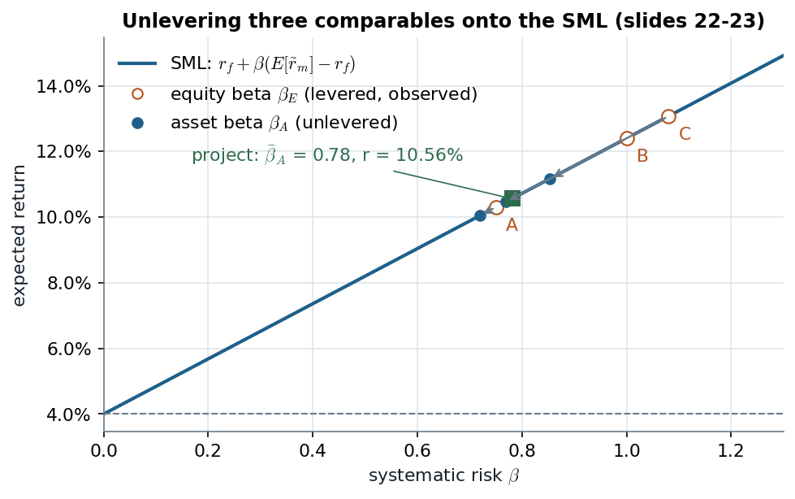

# 2A.1–2A.2 · Present value, the CAPM discount rate, and unlevering a comparable's beta

> **Claim.** An asset is worth its expected cash flows discounted at the return investors require
> for bearing its **systematic** risk. For a project there is no price history, so its beta is
> borrowed from a traded firm with similar assets. That firm's observable **equity** beta mixes
> business risk with leverage, so it is first **unlevered**: because $A=D+E$ in market value,
> returns and betas of the assets are value-weighted averages of those of debt and equity.

Prev: — · Next: [[L02-02-cash-flows-npv-irr]] · Map: [[L02-00-map]]

**Notation.**

| Symbol | Meaning | Range |
|---|---|---|
| $P_A$ | price (value) at $t=0$ of asset/project $A$ | $\mathbb{R}$ |
| $\tilde d_t$ | random cash flow at date $t=1,\dots,T$ ($T\to\infty$ allowed) | $\mathbb{R}$ |
| $r_t$ | expected return (discount rate) for a date-$t$ cash flow; $r$ if constant | $>-1$ |
| $\tilde r$, $r=E[\tilde r]$ | realized and expected return | — |
| $r_f$ | risk-free rate | $>-1$ |
| $\tilde r_m$, $E[\tilde r_m]$ | market return and its mean | — |
| $\beta=\operatorname{Cov}(\tilde r,\tilde r_m)/\operatorname{Var}(\tilde r_m)$ | systematic risk | $\mathbb{R}$ |
| $A,D,E$ | **market** values of assets, debt, equity of a firm, $A=D+E$ | $\ge 0$ |
| $\tilde C_A,\tilde C_D,\tilde C_E$ | cash flows at $t=1$ to assets, debt, equity, $\tilde C_A=\tilde C_D+\tilde C_E$ | — |
| $r_A,r_D,r_E$; $\beta_A,\beta_D,\beta_E$ | expected returns and betas of assets, debt, equity | — |
| $C$, $F$, $N$ | bond coupon, face value, maturity | $\ge0$ |

---

## 1 · C — The price of an asset is a present value

The asset generates a random stream $\tilde d_1,\dots,\tilde d_T$ (slide 2). Its price is the
expected present value (slide 4):

$$P_A=\sum_{t=1}^{T}\frac{E[\tilde d_t]}{(1+r_t)^t}\tag{1.1}$$

- $r_t=E[\tilde r_t]$ is an **expected** return. The **realized** return $\tilde r_t$ is random
  because the $\tilde d_t$ are, so ex post it can land above or below $r_t$ (slide 4).
- The value is computed **regardless of how the asset is financed** (slide 3): (1.1) prices the
  asset, not any claim on it. Why that is legitimate is exactly MM I ([[L02-06-mm1-arbitrage-put-call]]).

**Riskless case (slide 5).** With $r_t$ the $t$-year spot rate, a coupon bond paying $C$ at
$t=1,\dots,N$ and $F$ at $N$ is (1.1) with $E[\tilde d_t]=d_t$ known:

$$P=\frac{C}{1+r_1}+\frac{C}{(1+r_2)^2}+\dots+\frac{C}{(1+r_{N-1})^{N-1}}+\frac{C+F}{(1+r_N)^N}\tag{1.2}$$

*Illustration (numbers chosen here, not on the slides):* $N=2$, $C=5$, $F=100$, $r_1=4\%$,
$r_2=5\%$. Substituting into (1.2):

$$P=\frac{5}{1.04}+\frac{5+100}{(1.05)^2}$$
$$P=4.8077+\frac{105}{1.1025}=4.8077+95.2381=100.0458$$

With a **time-invariant** rate $r_t=r$ (slide 6), (1.1) becomes

$$P_A=\sum_{t=1}^{T}\frac{E[\tilde d_t]}{(1+r)^t}.\tag{1.3}$$

The two hard inputs are the forecasts $E[\tilde d_t]$ ([[L02-02-cash-flows-npv-irr]]) and the
rate $r$ (this note). Slide 7:

$$\underbrace{r}_{\text{required expected return}}=\underbrace{r_f}_{\text{compensation for delaying consumption}}+\underbrace{\text{risk premium}}_{\text{compensation for bearing risk}}$$

---

## 2 · C — The CAPM rate

The risk premium comes from an asset-pricing model; the course uses the CAPM (slide 8):

$$r=E[\tilde r]=r_f+\beta\,\bigl(E[\tilde r_m]-r_f\bigr)\tag{1.4}$$
$$\beta=\frac{\operatorname{Cov}(\tilde r,\tilde r_m)}{\operatorname{Var}(\tilde r_m)},\qquad
\operatorname{Cov}(X,Y)=E\bigl[(X-E[X])(Y-E[Y])\bigr]=E[XY]-E[X]E[Y]\tag{1.5}$$

> **Only the market-covariance part of risk is priced.** $\beta$ is the quantity of systematic
> risk; $E[\tilde r_m]-r_f$ is its price, common to every asset. (Ross §13.7, p. 442 builds the
> same line from portfolios of a risky asset and the risk-free asset; Berk p. 368 quotes Sharpe:
> *"expected return is proportionate to beta relative to the market portfolio."*)

**Estimation (slide 9).** $r_f$: government bond yields at a maturity representative of the
project's duration. $E[\tilde r_m]-r_f$: slow-moving consensus values. $\beta$: from past
returns, for traded securities. **A project has no past returns** — hence comparables.

*U-layer example (Higgins pp. 302–303, his Eq. 8.2):* Polaris' equity beta 2.05, $r_f=1.7\%$,
market premium $6.4\%$:

$$K_E=1.7\%+2.05\times6.4\%$$
$$K_E=1.7\%+13.12\%=14.82\%\approx14.8\%$$

---

## 3 · C — Comparables: borrow the beta of similar assets

If a traded firm has assets with systematic risk $\beta_A$ similar to the project's, then the
project's beta is $\beta=\beta_A$ and, substituting into (1.4) (slide 10):

$$r=r_f+\beta_A\bigl(E[\tilde r_m]-r_f\bigr).\tag{1.6}$$

**The problem (slide 11):** only the comparable's **equity** beta $\beta_E$ is estimable from
stock prices. $\beta_D$ is estimable only if its debt trades — usually it does not (bank debt,
trade credit, illiquid bonds); fall-backs are bond indices of the same rating, or $\beta_D=0$
when leverage is low and default very unlikely.

> **Ross §14.5 (pp. 476–477) shows why one rate for everything fails:** with the firm's WACC of
> 15% as a single hurdle, a project of beta 0.60 expected to earn 14% is rejected, although its
> required return is only $7\%+0.60\times8\%=11.8\%$. One hurdle rate accepts too many risky
> projects and rejects too many safe ones; a **project-specific** beta fixes it (Berk §13.5,
> pp. 396–398, does the same with a pure-play comparable).

---

## 4 · C — Leverage raises equity risk: the house (slides 12–15)

A house worth 100 moves one-for-one with the market. The market return is $+10\%$ with
probability 0.8 and $-5\%$ with probability 0.2; $r_f=2\%$.

$$E[\tilde r_m]=0.8(0.10)+0.2(-0.05)=0.08-0.01=0.07\tag{1.7}$$
$$\operatorname{Var}(\tilde r_m)=0.8(0.10-0.07)^2+0.2(-0.05-0.07)^2=0.8(0.0009)+0.2(0.0144)=0.0036\tag{1.8}$$

So $r_A=r_m=7\%$ and $\beta_A=1$; tomorrow the house is worth $100(1.10)=110$ or $100(0.95)=95$.

**Case 1 — 20% debt.** Debt $D=20$ is riskless: it pays $20(1.02)=20.4$ in both states.
Equity $E=80$ gets the residual: $110-20.4=89.6$ (up) and $95-20.4=74.6$ (down).

| | Today | Up | Down | Return up | Return down | Mean | Beta |
|---|---|---|---|---|---|---|---|
| A | 100 | 110 | 95 | 10% | −5% | 7% | 1 |
| D | 20 | 20.4 | 20.4 | 2% | 2% | 2% | 0 |
| E | 80 | 89.6 | 74.6 | 12% | −6.75% | **8.25%** | **1.25** |

Equity returns: $89.6/80-1=0.12$ and $74.6/80-1=-0.0675$. Then

$$E[\tilde r_E]=0.8(0.12)+0.2(-0.0675)=0.096-0.0135=0.0825$$
$$\operatorname{Cov}(\tilde r_E,\tilde r_m)=0.8(0.12-0.0825)(0.03)+0.2(-0.0675-0.0825)(-0.12)=0.0009+0.0036=0.0045$$
$$\beta_E=\frac{0.0045}{0.0036}=1.25$$

> **The slide prints the down return as −7% and the mean as 8%** (slide 14): both are rounded
> from −6.75% and 8.25%. The beta, 1.25, is exact. Check with (1.12) below:
> $r_E=7\%+\tfrac{20}{80}(7\%-2\%)=8.25\%$.

**Case 2 — 50% debt.** $D=50$ pays 51; equity 50 gets 59 or 44, returns $+18\%$ and $-12\%$:

$$E[\tilde r_E]=0.8(0.18)+0.2(-0.12)=0.144-0.024=0.12$$
$$\operatorname{Cov}(\tilde r_E,\tilde r_m)=0.8(0.06)(0.03)+0.2(-0.24)(-0.12)=0.00144+0.00576=0.0072$$
$$\beta_E=\frac{0.0072}{0.0036}=2$$

> **In both cases $r_E>r_A$ and $\beta_E>\beta_A$** (slide 15). The equity of a highly levered
> firm **overstates** the risk of its assets (slide 12). The house did not change; only the
> claim on it did.

---

## 5 · C — Unlevering: asset returns and betas are value-weighted averages

**First derivation (slide 17).** All cash generated by the assets goes to debt- or
equityholders, so investing 1 in the assets is investing $D/(D+E)$ in the debt and $E/(D+E)$ in
the equity.

**Second derivation (slides 18–19).** One-period firm. Each value is its expected payoff
discounted at its own expected return:

$$D=\frac{E[\tilde C_D]}{1+r_D},\qquad E=\frac{E[\tilde C_E]}{1+r_E},\qquad A=\frac{E[\tilde C_A]}{1+r_A}\tag{1.9}$$

Take $A$ from (1.9) and use $\tilde C_A=\tilde C_E+\tilde C_D$ (linearity of $E[\cdot]$):

$$A=\frac{E[\tilde C_E]+E[\tilde C_D]}{1+r_A}$$

Substitute $E[\tilde C_E]=E(1+r_E)$ and $E[\tilde C_D]=D(1+r_D)$, both from (1.9):

$$A=\frac{\bigl(E(1+r_E)\bigr)+\bigl(D(1+r_D)\bigr)}{1+r_A}$$

Multiply by $(1+r_A)/A$:

$$1+r_A=\frac{E}{A}(1+r_E)+\frac{D}{A}(1+r_D)$$

Use $A=D+E$, so $E/A+D/A=1$, and subtract 1 from both sides:

$$\boxed{\;r_A=\frac{E}{D+E}\,r_E+\frac{D}{D+E}\,r_D\;}\tag{1.10}$$

**Realized returns (slide 20).** The same steps with $D=\tilde C_D/(1+\tilde r_D)$, etc., give
$\tilde r_A=\frac{E}{D+E}\tilde r_E+\frac{D}{D+E}\tilde r_D$ state by state. The weights
$D/(D+E)$ and $E/(D+E)$ are **today's values — constants**.

**Betas (slide 21).** Covariance is linear and the weights are constants:

$$\operatorname{Cov}(\tilde r_A,\tilde r_m)=\operatorname{Cov}\Bigl(\tfrac{E}{D+E}\tilde r_E+\tfrac{D}{D+E}\tilde r_D,\ \tilde r_m\Bigr)=\tfrac{E}{D+E}\operatorname{Cov}(\tilde r_E,\tilde r_m)+\tfrac{D}{D+E}\operatorname{Cov}(\tilde r_D,\tilde r_m)$$

Divide by $\operatorname{Var}(\tilde r_m)$ and use (1.5) term by term:

$$\boxed{\;\beta_A=\frac{E}{D+E}\,\beta_E+\frac{D}{D+E}\,\beta_D\;}\tag{1.11}$$

Solving (1.10) and (1.11) for the equity side gives the **relevering** forms used later:

$$r_E=r_A+\frac{D}{E}(r_A-r_D),\qquad \beta_E=\beta_A+\frac{D}{E}(\beta_A-\beta_D)\tag{1.12}$$

(multiply (1.10) by $(D+E)/E$: $\frac{D+E}{E}r_A=r_E+\frac{D}{E}r_D$, then write
$\frac{D+E}{E}r_A=r_A+\frac{D}{E}r_A$). **With $\beta_D=0$**, (1.11) is
$\beta_A=\frac{E}{D+E}\beta_E$ (slide 23; Higgins p. 319, who adds that
$\beta_A=\beta_E$ for an all-equity firm and that $\beta_E$ rises above $\beta_A$ as leverage
grows).

> **Which assumption drives (1.10)–(1.11)?** Only $A=D+E$ in **market value** and
> $\tilde C_A=\tilde C_D+\tilde C_E$ — no CAPM, no MM. They are accounting identities for
> market values. MM I adds that $A$ (hence $r_A$) does not move when $D/E$ moves
> ([[L02-07-mm2-wacc-cost-of-debt]]).

---

## 6 · C — Worked example: three comparables (slides 22–23)

$r_f=4\%$, $E[\tilde r_m]=12.4\%$; the comparables' debt is risk-free ($\beta_D=0$); book debt
proxies market debt; all three are equally good comparables.

| Firm | $\beta_E$ | $D$ | $E$ | $E/(D+E)$ | $\beta_A=\frac{E}{D+E}\beta_E$ |
|---|---|---|---|---|---|
| A | 0.75 | 0.004 | 0.096 | $0.096/0.100=0.96$ | $0.96\times0.75=0.72$ |
| B | 1.00 | 2.3 | 7.7 | $7.7/10.0=0.77$ | $0.77\times1.00=0.77$ |
| C | 1.08 | 0.21 | 0.79 | $0.79/1.00=0.79$ | $0.79\times1.08=0.8532$ |
| Average | | | | | $(0.72+0.77+0.8532)/3=0.7811$ |

Substituting $\bar\beta_A=0.7811$ into (1.6):

$$r=4\%+0.7811\,(12.4\%-4\%)$$
$$r=4\%+0.7811\times8.4\%=4\%+6.561\%=10.56\%$$

> **The slide shows 0.78 but uses the unrounded 0.7811:** $0.78\times8.4\%=6.552\%$ would give
> 10.55%. Average the **asset** betas, never the equity betas: the equity-beta average,
> $(0.75+1+1.08)/3=0.943$, would charge $4\%+0.943\times8.4\%=11.92\%$.

*Unlevering moves each comparable down the SML; the project sits at the average asset beta (eq. 1.6, 1.11; slides 22–23).*

Each arrow is the leverage premium the equity beta carried. Firm A is almost all equity, so it
barely moves; B and C move most because their debt is 21–23% of value. The project's rate is
read at the green square, below B's and C's equity points.

**U-layer check (Higgins p. 319).** Polaris: $E=5{,}898$, $V=D+E=7{,}334$ (millions), $\beta_E=2.05$:

$$\beta_A=\frac{5{,}898}{7{,}334}\times2.05=0.80420\times2.05=1.65$$

---

## 7 · G — Risky debt in the beta formula

If debt is risky, $\beta_D\ne0$ and (1.12) keeps its last term. Amaro de Matos (§2.1.2, p. 43)
writes the levered equity beta as
$\beta_s=\beta_s^u\bigl(1+\tfrac{B}{S}\bigr)-\beta_d\tfrac{B}{S}$, which is (1.12) with
$S=E$, $B=D$, $\beta^u_s=\beta_A$. Setting $\beta_D=0$ when debt is risky **overstates** the
asset beta: the equity beta absorbs part of the risk that the debt in fact bears.

---

## Links

- Next: which cash flows to discount → [[L02-02-cash-flows-npv-irr]]. The identity (1.10) at work
  with state prices → [[L02-05-entrepreneur-example]] §5; MM II is (1.12) with $r_A$ fixed →
  [[L02-07-mm2-wacc-cost-of-debt]].
- Topic 1 supplies $A=D+E$ in market value → [[../L01/L01-00-map|L01]]; taxes change the
  unlevering formula → [[../L03/L03-00-map|L03]].
- Rules: [[../../rules/02_valuation|rules/02 — valuation]].
- Block map: [[../../Map/lectures-index|Map/lectures-index]] (Topic 2A, blocks 2A.1–2A.2).
- **Practice.** [lista-r2](../../Listas/lista-r2-valuation.md) #2 (Berk Ch. 12 Ex. 24, p. 377),
  #5 (Higgins Ch. 8 Ex. 7, p. 328), #6 (Grinblatt–Titman Ch. 11 Ex. 11.10–11.13, p. 416),
  #9 (Berk Ch. 13 Ex. 20, p. 405); PS2 Ex. 4(a) ([PS2](../../Listas/PS2.pdf), pp. 2–3);
  [quiz Topic 2A](../../Simulados/quiz-topic2a-valuation-mm-2026-10-24.md), block `val`.
