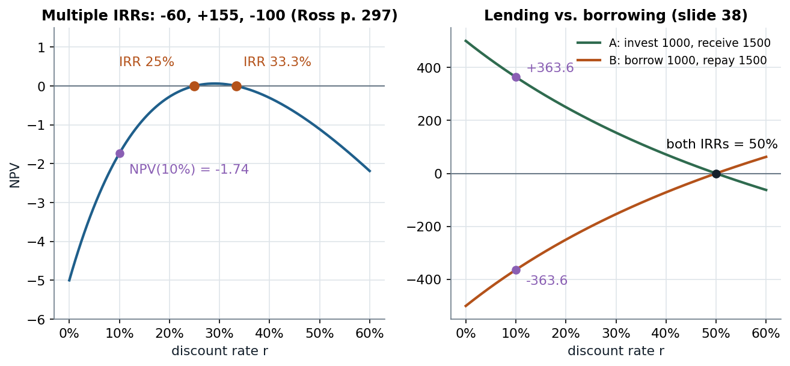

# 2A.3–2A.4 · Which cash flows, the NPV rule, and why the IRR misleads

> **Claim.** Discount the **unlevered free cash flow** — what the assets throw off for all
> investors, computed as if all-equity — on an **incremental** basis. Accept projects with
> positive NPV: in a frictionless all-equity firm, the NPV is exactly the gain of the current
> shareholders, **whichever way the project is financed**. The IRR agrees with the NPV only for
> conventional, independent projects; otherwise it can have several values, none, or the wrong sign.

Prev: [[L02-01-present-value-capm-betas]] · Next: [[L02-03-debt-vs-equity-claims]] · Map: [[L02-00-map]]

**Notation.**

| Symbol | Meaning | Range |
|---|---|---|
| $\mathrm{FCF}_t$ | unlevered free cash flow at $t$ | $\mathbb{R}$ |
| $\mathrm{EBIT}_t$, $\tau$ | earnings before interest and taxes; effective tax rate | $\tau\in[0,1)$ |
| $\mathrm{Dep}_t$, $\mathrm{CAPEX}_t$ | depreciation; capital expenditure | $\ge0$ |
| $\mathrm{NWC}_t$ | net working capital = receivables + inventories − payables | $\mathbb{R}$ |
| $g$ | perpetual growth rate of FCF after the horizon, $g<r$ | — |
| $\mathrm{TV}_T$, $SV$, $\mathrm{PPE}$ | terminal value at $T$; salvage value; book value of the assets sold | — |
| $c_A$, $PV_A$, $NPV_A$ | cost at $t=0$; value of the cash flows; $PV_A-c_A$ | — |
| $\mathrm{IRR}$ | rate solving $NPV=0$ | $>-1$ |
| $\alpha$ | share of the firm sold to new shareholders | $[0,1]$ |
| $F$ | face value of debt (here $F=16.5$) | $\ge0$ |

---

## 1 · C — The free cash flow (slides 24–25)

Investors care about the cash they can extract. The cash available to **all** investors is

$$\mathrm{FCF}_t=\mathrm{EBIT}_t(1-\tau)+\mathrm{Dep}_t-\mathrm{CAPEX}_t-\Delta\mathrm{NWC}_t\tag{2.1}$$

with $\mathrm{NWC}_t=$ accounts receivable + inventories − accounts payable. Projections of
$\mathrm{FCF}_t$ stand in for $E[\tilde d_t]$ in (1.1).

> **What is left out, and why.** (2.1) taxes EBIT **as if the firm had no debt**: subsidies
> created by financing — the interest tax shield — are not in the cash flow. They are accounted
> for **in the discount rate** (slide 25; the after-tax WACC of [[../L03/L03-00-map|L03]]).
> Adding them to the cash flow as well would count them twice.

*U-layer:* Berk writes the same cash flow as
$\mathrm{FCF}=(\text{Revenues}-\text{Costs})(1-\tau)-\mathrm{CAPEX}-\Delta\mathrm{NWC}+\tau\,\mathrm{Dep}$
(Eq. 9.7, p. 259): depreciation matters only through the **depreciation tax shield**
$\tau\,\mathrm{Dep}$. His example: at $\tau=40\%$, a depreciation of 200,000 saves
$0.40\times200{,}000=80{,}000$ of tax, raising FCF from 600,000 to 680,000.

---

## 2 · C — Incremental, opportunity, sunk, inflation, terminal value (slides 26–27)

1. **Incremental.** Cash flow *with* the project minus cash flow *without* it.
2. **Opportunity costs are in:** a resource the firm already owns is charged at its value in its
   best alternative use.
3. **Sunk costs are out:** costs the firm is already liable for whatever it decides (Ross §10.2,
   p. 320: *"tal custo é claramente irrelevante para a decisão em questão"*; Higgins p. 263 drops
   2 million of already-incurred preliminary engineering by the *with–without principle*).
4. **Inflation consistently:** nominal flows at nominal rates, real flows at real rates.
5. **Horizon.** Project 5–10 years, then a terminal value: liquidation, or growth at a constant
   rate in perpetuity.
6. **Salvage value** $SV=$ liquidation price − liquidation costs, **taxed on** $SV-\mathrm{PPE}$
   (the gain over book value):
   $$\text{after-tax salvage}=SV-\tau\,(SV-\mathrm{PPE})\tag{2.2}$$
7. **NWC is recouped** at the project's end: the last year carries $+\mathrm{NWC}_{T-1}$.

**The growing-perpetuity terminal value, derived.** If $\mathrm{FCF}_{T+k}=\mathrm{FCF}_{T+1}(1+g)^{k-1}$
for $k\ge1$, then at date $T$

$$\mathrm{TV}_T=\sum_{k=1}^{\infty}\frac{\mathrm{FCF}_{T+1}(1+g)^{k-1}}{(1+r)^k}=\frac{\mathrm{FCF}_{T+1}}{1+r}\sum_{k=0}^{\infty}\Bigl(\frac{1+g}{1+r}\Bigr)^k$$

The geometric series converges iff $(1+g)/(1+r)<1$, i.e. $g<r$, to $1/\bigl(1-\frac{1+g}{1+r}\bigr)=\frac{1+r}{r-g}$:

$$\mathrm{TV}_T=\frac{\mathrm{FCF}_{T+1}}{1+r}\cdot\frac{1+r}{r-g}=\frac{\mathrm{FCF}_{T+1}}{r-g}\tag{2.3}$$

and it enters (1.3) discounted by $(1+r)^T$.

---

## 3 · C — The NPV rule (slides 28–30)

$$NPV_A=PV_A-c_A\tag{2.4}$$

**Rule:** undertake the project iff $NPV_A>0$.

- $PV_A$ is the value of the cash flows **inside** the firm; $c_A$ is what they cost **outside**
  it. A positive NPV is an *"arbitrage" across the boundary of the firm*.
- It can survive in equilibrium because, unlike a financial arbitrage, it **is not scalable**.
- It enriches, in expectation, the **current claimants** — equity and debt together. How they
  split it can distort decisions (debt overhang, later in the course).
- **Acquisitions (slide 30).** Buying target $T$ at seller $S$'s price $c_T$ is positive-NPV iff
  $PV_T>c_T$, where $PV_T$ is $T$'s value *inside* acquirer $P$: synergies, scale/scope,
  better management, or market power can make it exceed $c_T$.

Berk states the same rule as *"take the alternative with the highest NPV. Choosing this
alternative is equivalent to receiving its NPV in cash today"* (p. 213); Ross §9.1 (p. 282)
and Higgins (p. 246) build it from the time value of money.

---

## 4 · C — Worked example: NPV = shareholders' gain, three financings (slides 31–36)

**Setting.** Risk-neutral agents (or a project with $\beta=0$), so every discount rate is
$r_f=10\%$; no taxes; all-equity firm; symmetric information. Assets in place are worth 100
(boom) or 10 (slump), probability 0.5 each. A safe project costs 15 at $t=0$ and pays 22 in
both states.

$$NPV=-15+\frac{22}{1.10}=-15+20=5\tag{2.5}$$

**(a) Insiders pay the 15.**

$$E_{\text{without}}=\frac{0.5\times100+0.5\times10}{1.10}=\frac{55}{1.10}=50$$
$$E_{\text{with}}=\frac{0.5\times(100+22)+0.5\times(10+22)}{1.10}=\frac{61+16}{1.10}=\frac{77}{1.10}=70$$
$$\text{gain}=(70-50)-15=5=NPV$$

**(b) New equity.** Competitive investors pay 15 for a share $\alpha$ and break even:

$$\alpha\cdot\frac{0.5\times(100+22)+0.5\times(10+22)}{1.10}=15$$
$$\alpha\cdot70=15\ \Longrightarrow\ \alpha=\frac{15}{70}$$

Old shareholders keep $1-\alpha=55/70$:

$$\frac{55}{70}\times70=55,\qquad \text{gain}=55-50=5=NPV$$

**(c) Safe debt.** Lenders pay 15 for a promise $F$ that is paid in both states (the slump
payoff $10+22=32>F$):

$$\frac{F}{1.10}=15\ \Longrightarrow\ F=16.5$$
$$E=\frac{0.5\times(100+22-16.5)+0.5\times(10+22-16.5)}{1.10}=\frac{0.5\times105.5+0.5\times15.5}{1.10}=\frac{60.5}{1.10}=55$$
$$\text{gain}=55-50=5=NPV$$

> **Which assumptions deliver "NPV = shareholders' gain"?** Competitive outside investors
> (they take zero NPV, so the whole NPV stays inside), symmetric information (they price the new
> claim correctly), and **no risky debt outstanding** (no old creditor captures part of the
> gain). Slide 31 flags both failure cases: **leverage (risky debt)** and **asymmetric
> information**. Without frictions, the NPV rule *is* shareholder-value maximisation (slide 36).

---

## 5 · C — The IRR and its pitfalls (slides 37–38)

$$0=-c_A+\sum_{t=1}^{T}\frac{E[\tilde d_t]}{(1+\mathrm{IRR})^t}\tag{2.6}$$

**IRR rule:** accept iff IRR > discount rate. (2.6) is a polynomial of degree $T$ in
$x=1/(1+\mathrm{IRR})$; the pitfalls are properties of its roots.

**(i) Multiple roots — Ross' mine (pp. 297–298).** Cash flows $-60$, $+155$, $-100$:

$$NPV(r)=-60+\frac{155}{1+r}-\frac{100}{(1+r)^2}$$

Multiply by $-(1+r)^2$ and set $u=1+r$: $60u^2-155u+100=0$, so

$$u=\frac{155\pm\sqrt{155^2-4\cdot60\cdot100}}{2\cdot60}=\frac{155\pm\sqrt{24025-24000}}{120}=\frac{155\pm5}{120}$$
$$u\in\{1.25,\ 1.3333\}\ \Longrightarrow\ \mathrm{IRR}\in\{25\%,\ 33\tfrac13\%\}$$

At $r=10\%$: $NPV=-60+140.91-82.64=-1.74$ (Ross' table). **Both IRRs exceed 10%, yet the NPV is
negative** — the IRR rule says accept, the NPV rule says reject.

**(ii) No root.** *Illustration chosen here:* $+100$, $-300$, $+250$. With $x=1/(1+r)$,
$NPV=100-300x+250x^2$ has discriminant $300^2-4\cdot250\cdot100=90{,}000-100{,}000<0$: the NPV is
positive at every rate and no IRR exists (Higgins p. 258 names the case).

**(iii) Lending vs. borrowing (slide 38).**

| Project | $t=0$ | $t=1$ | IRR | NPV at 10% |
|---|---|---|---|---|
| A | −1000 | +1500 | 50% | $-1000+1500/1.1=+363.6$ |
| B | +1000 | −1500 | 50% | $1000-1500/1.1=-363.6$ |

Same IRR, opposite NPVs: A *lends* at 50% (good), B *borrows* at 50% (bad).

*Left: two IRRs, negative NPV at the 10% cost of capital (Ross pp. 297–298). Right: one IRR for a loan and a borrowing (slide 38). Eq. (2.6).*

Read the left panel at the cost of capital, not at the roots: the NPV is positive only between
25% and 33⅓%. On the right, the sign of the slope tells lending (NPV falls with $r$) from
borrowing (NPV rises with $r$); the IRR alone cannot.

**(iv) Scale, mutually exclusive projects (slide 38).**

| Project | $t=0$ | $t=1$ | IRR | NPV at 10% |
|---|---|---|---|---|
| A | −10 | 14.3 | $14.3/10-1=43\%$ | $-10+14.3/1.1=3$ |
| B | −1000 | 1210 | $1210/1000-1=21\%$ | $-1000+1210/1.1=100$ |

The IRR ranks A first; the NPV, which measures the wealth created, ranks B first. Higgins
(p. 258) calls this *"a second, more serious problem"*; Berk works multiple IRRs on Evan's
deal (IRRs 5.79% and 13.80%, pp. 221–223).

---

## 6 · G — Why the NPV rule is preference-free: Fisher separation

Amaro de Matos (§1.1.5, pp. 11–12) adds an investment schedule with marginal return $\phi(I)$ to
a consumer with access to a capital market at rate $r$. The first-order condition in the
investment level does not involve the utility function:

$$\epsilon^*=\begin{cases}0 & r\ge\phi(0)\\ \phi^{-1}(r) & \phi(0)\ge r\end{cases}$$

**Proposition 1.1.1 (Fisher separation, p. 12):** the optimal production decision is fixed by an
objective market criterion (invest until the marginal return equals $r$), independent of
preferences. §1.1.6 (p. 14) shows the investment raises current wealth by
$\Delta/(1+r)$, with $\Delta=\int_0^{\phi^{-1}(r)}[\phi(I)-r]\,dI$ — **the NPV**. Everyone
who owns the firm agrees to maximise it, whatever their time preferences. This is the
foundation slide 36 states in words.

---

## Links

- Prev: the discount rate → [[L02-01-present-value-capm-betas]]. The financing-irrelevance in §4
  is a special case of MM I → [[L02-06-mm1-arbitrage-put-call]].
- FCF and NWC definitions come from Topic 1 → [[../L01/L01-00-map|L01]]; the tax shield left out
  of (2.1) returns in [[../L03/L03-00-map|L03]].
- Rules: [[../../rules/02_valuation|rules/02 — valuation]].
- Python: `npv`, `irr_roots` in [[L02-10-python]].
- **Practice.** PS1 Ex. 2 (incremental FCF, sunk fee, NWC; [PS1](../../Listas/PS1.pdf) p. 1) and
  Ex. 3 (replacement decision, tax on sale vs. book value; pp. 1–2).
  [lista-r2](../../Listas/lista-r2-valuation.md) #1 (Berk Ch. 8 Ex. 2, p. 241),
  #3 (Berk Ch. 9 Ex. 18, p. 276), #7 (Berk Ch. 8 Ex. 26, p. 244), #8 (Berk Ch. 8 Ex. 17, p. 243),
  #10 (Higgins Ch. 8 Ex. 16, p. 330), #11 (Berk Ch. 9 Ex. 25, p. 277),
  #12 (Higgins Ch. 9 Ex. 11, p. 382), #13 (Ross Cap. 10 Ex. 31, p. 356), #15 (Amaro 1.2.6 #4,
  p. 28); roadmap [roteiro-r2](../../Listas/roteiro-r2-valuation.md).
