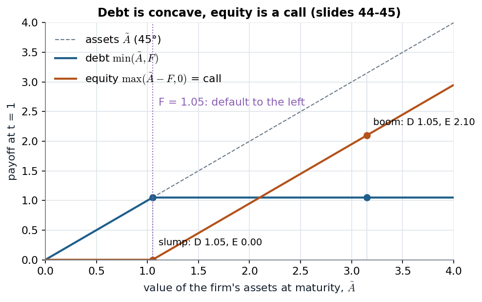

# 2A.5 · Debt and equity: two claims on one payoff, and equity as a call

> **Claim.** Capital structure is the composition of the claims on the firm's assets. Debt is a
> fixed, senior, finite-maturity promise without votes; equity is the residual, perpetual,
> voting claim. Under limited liability their payoffs are $\min(\tilde A,F)$ and
> $\max(\tilde A-F,0)$: **they always add up to $\tilde A$**, debt is concave in the assets and
> equity is a **call option** on them with strike $F$.

Prev: [[L02-02-cash-flows-npv-irr]] · Next: [[L02-04-complete-markets-state-prices]] · Map: [[L02-00-map]]

**Notation.**

| Symbol | Meaning | Range |
|---|---|---|
| $\tilde A$ | value of the firm's assets at maturity $t=1$ | $\ge0$ |
| $F$ | face value of a one-period zero-coupon debt contract | $\ge0$ |
| $\tilde C_D,\tilde C_E$ | payoffs to debt and to equity at $t=1$ | $\ge0$ |
| $C(F)$, $P(F)$ | price today of a call / put on the assets with strike $F$ | $\ge0$ |
| $r_f$ | risk-free rate | — |

---

## 1 · C — Four differences, and the contractual fringe (slides 39–42)

| | Debt | Equity |
|---|---|---|
| (i) Payoff | fixed promised payments at fixed dates | variable: residual claimant |
| (ii) Seniority | senior: paid first | paid only after debt promises are met |
| (iii) Maturity | always fixed | perpetual |
| (iii′) Legal rights | no control rights | voting rights |

(The slides number the fourth item "(iii)" twice.) Around the core:

- **Covenants** protect lenders without votes: limits on dividends, repurchases, new (especially
  senior or secured) debt; clauses transferring control if maximum leverage, minimum net worth
  (book assets − book liabilities) or minimum liquidity are breached. A breach other than missing
  principal or interest is a **technical default** (slide 41).
- **Default** lets the lender seize the firm's assets and take control, leaving equity with
  nothing. **Limited liability**: only the firm's assets can be seized, never the owners'
  personal assets. Lenders can also report the default to a **credit bureau** (slide 42).

*G-layer:* Tirole's Figure 2.3 (p. 77) ranks the claims by priority — secured debt, ordinary
debt, subordinated debt, preferred stock, common stock — and adds hybrids such as convertible
debt, which he reads as protection for lenders against risk-taking (p. 77).

---

## 2 · C — The payoffs (slides 43–45)

The firm finances itself at $t=0$ with the owner's money and a one-period debt promising $F$ at
$t=1$; $\tilde A$ may be above or below $F$, so **the debt is risky**.

- $\tilde A<F$: default; senior creditors take everything, $\tilde A$; equity gets 0.
- $\tilde A\ge F$: creditors get $F$; equity gets $\tilde A-F$.

$$\tilde C_D=\min(\tilde A,F)\tag{3.1}$$
$$\tilde C_E=\max(\tilde A-F,0)\tag{3.2}$$

**They add up.** If $\tilde A\ge F$: $F+(\tilde A-F)=\tilde A$. If $\tilde A<F$: $\tilde A+0=\tilde A$. So

$$\tilde C_D+\tilde C_E=\tilde A\quad\text{in every state.}\tag{3.3}$$

(3.2) is, term for term, the payoff of a **call on $\tilde A$ with strike $F$**, so equity's
value is $C(F)$. (3.1) can be rewritten (proved in [[L02-06-mm1-arbitrage-put-call]] §4):

$$\min(\tilde A,F)=F-\max(F-\tilde A,0)\tag{3.4}$$

a riskless bond of face $F$ **minus a put** on the assets with strike $F$.

*Debt (3.1) is concave, equity (3.2) is convex and their sum is the 45° line (3.3); dots are the entrepreneur's project financed with debt of face 1.05 (slides 45, 58).*

The kink at $F$ is the whole story: left of it creditors bear the losses one for one, right of it
shareholders take every extra unit. In the entrepreneur's economy, face 1.05 sits exactly at the
slump payoff, so the debt never defaults and equity is worth something only in the boom.

**Worked (slides 55, 58).** Assets pay 1.05 (slump) or 3.15 (boom); $F=1.05$. From (3.1)–(3.2):

| | Slump | Boom |
|---|---|---|
| $\tilde A$ | 1.05 | 3.15 |
| Debt $\min(\tilde A,1.05)$ | 1.05 | 1.05 |
| Equity $\max(\tilde A-1.05,0)$ | 0 | 2.10 |
| Sum (3.3) | 1.05 | 3.15 |

With $F=2.1$ instead, debt pays $\min(1.05,2.1)=1.05$ and $\min(3.15,2.1)=2.1$ and **defaults in
the slump**; equity pays 0 and 1.05.

---

## 3 · U — Why the call shape creates a conflict (slide 45, forward)

A convex payoff gains from spreading outcomes; a concave one loses. *Illustration chosen here:*
keep $F=1.05$ and replace the asset outcomes $(1.05,\ 3.15)$ by $(0,\ 4.2)$, same mean
$\tfrac12(1.05+3.15)=\tfrac12(0+4.2)=2.1$, states equally likely.

| | Mean before | Mean after |
|---|---|---|
| Equity $\max(\tilde A-1.05,0)$ | $\tfrac12(0)+\tfrac12(2.1)=1.05$ | $\tfrac12(0)+\tfrac12(3.15)=1.575$ |
| Debt $\min(\tilde A,1.05)$ | $\tfrac12(1.05)+\tfrac12(1.05)=1.05$ | $\tfrac12(0)+\tfrac12(1.05)=0.525$ |

Total expected payoff is unchanged ($2.1$); **0.525 moves from creditors to shareholders.**
Tirole (p. 77): *"(diversified) equityholders like (mean-preserving) increases in risk while
debtholders dislike such increases in risk."* That is why covenants exist; the agency topics
take it up.

---

## 4 · G — The first irrelevance proof, in one line (Tirole p. 78)

With risk-neutral investors and repayment $D$ on income $R$,
$V_E+V_D=E[\max(0,R-D)]+E[\min(R,D)]=E[R]$, independent of $D$: (3.3) under the expectation.
Tirole's footnotes 8–9 add that risk neutrality is not needed — with risk-averse investors one
prices each state with *state-contingent prices* and applies the same equality. That is the
route [[L02-04-complete-markets-state-prices]] and [[L02-05-entrepreneur-example]] take; Amaro
de Matos does it in general (p. 41: $B_j(T)=\min\{F,V_j(T)\}$, eq. 2.2:
$S_j(T)=\max[0,V_j(T)-F]$, so $V_j(T)=S_j(T)+B_j(T)$).

---

## Links

- The put–call rewriting (3.4) and MM I with risky debt → [[L02-06-mm1-arbitrage-put-call]] §4.
- Pricing these payoffs state by state → [[L02-04-complete-markets-state-prices]].
- Risk-shifting as a cost of distress → [[../L03/L03-00-map|L03]].
- Rules: [[../../rules/03_benchmark_mm|rules/03 — MM benchmark]].
- Interactive: [The State-Price Balance Sheet](companions/companion-mm-state-prices.html) — move
  $F$ across the slump payoff and watch the debt turn risky.
- **Practice.** PS2 Ex. 1 (calls and puts on the project's assets; [PS2](../../Listas/PS2.pdf)
  p. 1); [lista-r3](../../Listas/lista-r3-mm-taxes-tradeoff.md) #11 (Grinblatt–Titman
  Ex. 14.2–14.3, pp. 526–527).
