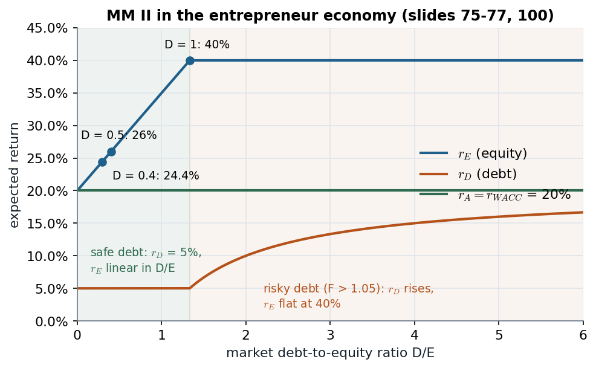

# 2A.7 · The penniless entrepreneur: one firm, every financing, the same value

> **Claim.** Price the project with state prices recovered from a stock and a bond. The firm is
> worth $A=1.75$ against a cost of 1, whether it is financed by debt, equity or any mix: outside
> investors break even, and the entrepreneur keeps the whole NPV of 0.75. The return on assets is
> fixed at 20%. **Leverage only moves risk between the claims**: the expected return on equity
> rises with $D/E$ in exactly the way that keeps $A$ constant. A table that holds $r_E$ fixed
> while borrowing more manufactures value that is not there.

Prev: [[L02-04-complete-markets-state-prices]] · Next: [[L02-06-mm1-arbitrage-put-call]] · Map: [[L02-00-map]]

**Notation.**

| Symbol | Meaning | Value / range |
|---|---|---|
| $X_s, X_b$ | project payoff in slump, boom | 1.05, 3.15 |
| $q$ | probability of each state | 0.5 |
| $p_1,p_2$ | price of the boom claim $cc_1$, slump claim $cc_2$ | 0.357, 0.595 |
| $x,y$ | units of stock and bond in a replicating portfolio | $\mathbb{R}$ |
| $\alpha$ | share of the firm sold to new shareholders for 1 | $[0,1]$ |
| $D$ | amount raised by debt ($1-D$ by equity) | $[0,1]$ |
| $A,D,E$ | market values of assets, debt, equity | — |
| $r_A,r_D,r_E$ | expected returns: expected payoff / value − 1 | — |

---

## 1 · C — Setting, and the book-vs-market question (slides 55–57)

The entrepreneur has no money and must raise 1 at $t=0$. Two equally likely states:

| | Investment $t=0$ | Slump | Boom | Expected return on the investment |
|---|---|---|---|---|
| Project | 1 | 1.05 | 3.15 | $\tfrac12(1.05+3.15)/1-1=110\%$ |
| Stock | price 1 | 0 | 2.8 | $\tfrac12(0+2.8)/1-1=40\%$ |
| Bond | price 1 | 1.05 | 1.05 | 5% |

Investors trade the stock and the bond freely, short sales included. Options: issue debt (it can
be riskless — 1.05 is paid in both states), sell a share $\alpha$ of equity for 1, or raise $D$ by
debt and $1-D$ by equity. **Is $r_A=110\%$?** No: 1 is the **book** value of the assets, the cost.
$r_A$ is defined on the **market** value, which we do not know yet.

---

## 2 · C — The state prices (slides 60–67)

A portfolio of $x$ stocks and $y$ bonds pays $1.05y$ in the slump and $2.8x+1.05y$ in the boom
and costs $x\cdot1+y\cdot1$ (in general $xS_0+yB_0$; slide 64).

**$cc_1$, pays $(0,1)$** (slide 65):

$$1.05y=0\tag{5.1}$$
$$2.8x+1.05y=1\tag{5.2}$$

(5.1) gives $y=0$; substituting into (5.2): $2.8x+1.05(0)=1$, so $x=1/2.8$.

$$p_1=x+y=\frac{1}{2.8}+0=0.357\tag{5.3}$$

**$cc_2$, pays $(1,0)$** (slide 66):

$$1.05y=1\ \Longrightarrow\ y=\frac{1}{1.05}$$
$$2.8x+1.05\Bigl(\frac{1}{1.05}\Bigr)=0\ \Longrightarrow\ x=-\frac{1}{2.8}\quad\text{(short the stock)}$$
$$p_2=x+y=-\frac{1}{2.8}+\frac{1}{1.05}=-0.357143+0.952381=0.595\tag{5.4}$$

> **Same probability, different price** (slide 67): $p_2>p_1$. Agents are risk-averse; a unit
> in the slump, when they are poorer, is worth more to them than a unit in the boom. $p_1+p_2=1/1.05$
> recovers $r_f=5\%$.

---

## 3 · C — Debt financing (slides 58, 61, 68)

Borrow 1 at 5%, promise $F=1.05$. Payoffs (debt is senior):

| | Slump | Boom |
|---|---|---|
| Total | 1.05 | 3.15 |
| Debt | 1.05 | 1.05 |
| Entrepreneur | 0 | 2.10 |

The entrepreneur's position pays $(0,\ 2.1)$ = **2.1 units of $cc_1$**; by the law of one price,

$$\text{entrepreneur}=2.1\,p_1=2.1\times0.357143=0.75\tag{5.5}$$
$$A=3.15\,p_1+1.05\,p_2=3.15(0.357143)+1.05(0.595238)=1.125+0.625=1.75\tag{5.6}$$

Lending is zero-NPV for competitive creditors, so the market value of the debt equals the cash
they put in, 1. **Under debt: $A=1.75$, $E=0.75$, $D=1$**, and $A=D+E$.

---

## 4 · C — Equity financing (slides 59, 62–63, 69)

New shareholders pay 1 for $\alpha$; the entrepreneur keeps $1-\alpha$:

| | Slump | Boom |
|---|---|---|
| Total | 1.05 | 3.15 |
| New shareholders | $1.05\alpha$ | $3.15\alpha$ |
| Entrepreneur | $1.05(1-\alpha)$ | $3.15(1-\alpha)$ |

The new holders' claim is $3.15\alpha$ units of $cc_1$ plus $1.05\alpha$ units of $cc_2$.
**Zero NPV for competitive investors** (slide 63):

$$1=\alpha\,(3.15\,p_1+1.05\,p_2)\tag{5.7}$$

Substitute (5.6), $3.15p_1+1.05p_2=1.75$:

$$1=\alpha\,(1.75)\ \Longrightarrow\ \alpha=\frac{1}{1.75}=\frac{4}{7}\tag{5.8}$$

The entrepreneur's position is $(1-\alpha)3.15$ units of $cc_1$ plus $(1-\alpha)1.05$ of $cc_2$:

$$\tfrac37\,(3.15\,p_1)+\tfrac37\,(1.05\,p_2)=\tfrac37\,(1.75)=0.75\tag{5.9}$$

New holders' claim is worth 1, total equity $0.75+1=1.75$. **Under equity: $A=E=1.75$.**

> **MM in one line** (slide 70): $A=1.75$ under both financings; investors take zero NPV; the
> entrepreneur keeps the NPV $1.75-1=0.75$ either way.

---

## 5 · C — The slide-81 exercise: replicate the positions directly

Slide 81 asks to price the entrepreneur's positions with the stock and the bond, skipping the
contingent claims. **Under debt**, target $(0,\ 2.1)$:

$$1.05y=0\ \Rightarrow\ y=0;\qquad 2.8x+1.05(0)=2.1\ \Rightarrow\ x=0.75$$
$$\text{cost}=0.75(1)+0(1)=0.75\ \checkmark$$

**Under equity**, target $\tfrac37(1.05,\ 3.15)=(0.45,\ 1.35)$:

$$1.05y=0.45\ \Rightarrow\ y=0.428571$$
$$2.8x+1.05(0.428571)=1.35\ \Rightarrow\ 2.8x=1.35-0.45=0.90\ \Rightarrow\ x=0.321429$$
$$\text{cost}=0.321429+0.428571=0.75\ \checkmark$$

---

## 6 · C — Returns under each financing (slides 71–72)

Expected payoffs use $q=0.5$; each return is expected payoff / market value − 1.

**Debt financing:**

| | Value | Slump | Boom | Expected payoff | Expected return |
|---|---|---|---|---|---|
| Debt | 1 | 1.05 | 1.05 | 1.05 | $1.05/1-1=5\%=r_D$ |
| Equity | 0.75 | 0 | 2.1 | 1.05 | $1.05/0.75-1=40\%=r_E$ |
| Assets | 1.75 | 1.05 | 3.15 | 2.10 | $2.10/1.75-1=20\%=r_A$ |

Check (1.10): $\frac{E}{D+E}r_E+\frac{D}{D+E}r_D=\frac{0.75}{1.75}(0.40)+\frac{1}{1.75}(0.05)=0.171429+0.028571=0.20=r_A$ ✓.

**Equity financing** ($D=0$): $E=A=1.75$, payoffs $(1.05,3.15)$, $r_E=r_A=20\%$. Check:
$\frac{1.75}{1.75}(0.20)+0=0.20$ ✓.

---

## 7 · C — Any mix $D\in[0,1]$: $r_A$ fixed, $r_E$ rising (slides 73–77)

For every $D\le1$ the face value $1.05D\le1.05$ is paid in both states, so debt is riskless and
$r_D=5\%$. The assets' payoffs and value do not depend on $D$, so neither does
$r_A=E[\tilde C_A]/A-1=20\%$ (slide 73). Rearranging (1.10) (slide 74):

$$r_E=\frac{E+D}{E}\,r_A-\frac{D}{E}\,r_D\tag{5.10}$$

Substitute $r_A=20\%$, $r_D=5\%$:

$$r_E=\frac{E+D}{E}(20\%)-\frac{D}{E}(5\%)=20\%+\frac{D}{E}(20\%)-\frac{D}{E}(5\%)=20\%+\frac{D}{E}\,15\%\tag{5.11}$$

Substitute $E=1.75-D$ (slide 75):

$$r_E=20\%+\frac{D}{1.75-D}\,15\%\tag{5.12}$$

Increasing and convex in $D$ (slide 76), **linear in $D/E$** (slide 77): at $D=1$,
$r_E=20\%+\frac{1}{0.75}15\%=40\%$.

**$D=0.4$ (slide 78).** Debt pays $0.4\times1.05=0.42$ in both states; equity pays
$1.05-0.42=0.63$ and $3.15-0.42=2.73$.

$$E=0.63\,p_2+2.73\,p_1=0.63(0.595238)+2.73(0.357143)=0.375+0.975=1.35$$
$$r_E=\frac{\tfrac12(0.63+2.73)}{1.35}-1=\frac{1.68}{1.35}-1=24.44\%$$

Check (5.12): $20\%+\frac{0.4}{1.35}15\%=20\%+4.44\%=24.44\%$ ✓.

| | Value | Slump | Boom | Expected return |
|---|---|---|---|---|
| Debt | 0.40 | 0.42 | 0.42 | 5% |
| Equity | 1.35 | 0.63 | 2.73 | 24.4% |
| Assets | 1.75 | 1.05 | 3.15 | 20% |

**The fallacy (slide 79).** Since $r_D<r_E$, borrow 0.5 and buy back equity? If the expected
returns stayed at 5% and 24.4%, equity paying $(0.525,\ 2.625)$ would be valued at

$$E^{\text{wrong}}=\frac{\tfrac12(0.525+2.625)}{1.2444}=\frac{1.575}{1.2444}=1.27,\qquad A^{\text{wrong}}=0.50+1.27=1.77>1.75.$$

**Correct values (slide 80)** come from the state prices, which do not care about labels:

$$E=0.525\,p_2+2.625\,p_1=0.525(0.595238)+2.625(0.357143)=0.3125+0.9375=1.25$$
$$r_E=\frac{1.575}{1.25}-1=26\%,\qquad A=0.5+1.25=1.75$$

Check (5.12): $20\%+\frac{0.5}{1.25}15\%=20\%+6\%=26\%$ ✓.

> **The expected return on equity must rise with leverage** (slide 79). Holding it fixed is
> the single most common way to "prove" that debt creates value in a frictionless market.

*The left, shaded part is slides 76–77 (safe debt, eq. 5.11); the right part extends the same economy past face 1.05, where debt defaults in the slump (eq. 7.6 in [[L02-07-mm2-wacc-cost-of-debt]]).*

The dots are the three tables of this note: 24.4%, 26%, 40%. To the left of $D/E=1.33$ the line
is (5.11); past it, an extra unit of promised debt buys only boom payoffs, so equity becomes pure
boom claims and its return freezes at $\tfrac12/p_1-1=40\%$.

*Price is linear in payoffs: $p_2\cdot$slump $+\ p_1\cdot$boom. Points on one line cost the same (slides 56, 60–69; eqs. 5.3–5.6).*

The stock and the bond both cost 1, so the line through them **is** the price-1 line; its slope
$-p_2/p_1=-1.667$ is the market's rate of exchange between slump and boom payoffs. Any split of
the project's point $(1.05,\,3.15)$ into two claims puts them on parallel lines whose prices add
to 1.75.

> **Interactive companion.** [The State-Price Balance Sheet](companions/companion-mm-state-prices.html)
> — load the slide presets ($D=1$, $0.4$, $0.5$, all equity), then drag $F$: $A$ never moves while
> $D$, $E$ and $r_E$ do.

---

## 8 · U — The same story in dollars: Berk's coffee shop (pp. 465–469)

Investment 24,000; cash flow 34,500 in one year, risk-free rate 5% plus a 10% risk premium, so
15%. Unlevered value and NPV:

$$V^U=\frac{34{,}500}{1.15}=30{,}000,\qquad NPV=30{,}000-24{,}000=6{,}000$$

Borrow 15,000 at 5% (repay $15{,}000\times1.05=15{,}750$): levered equity is worth
$30{,}000-15{,}000=15{,}000$ and expects $34{,}500-15{,}750=18{,}750$, a return of
$18{,}750/15{,}000-1=25\%$, not 15%. Discounting it at 15% would give
$18{,}750/1.15=16{,}304>15{,}000$ — the slide-79 fallacy in Berk's numbers (p. 467). With
6,000 of debt (repay 6,300), equity is 24,000 and expects $28{,}200/24{,}000-1=17.5\%$ (p. 469).
Either way the founder keeps the 6,000 NPV.

---

## Links

- The general proof by arbitrage → [[L02-06-mm1-arbitrage-put-call]]; MM II and the risky region
  of the figure → [[L02-07-mm2-wacc-cost-of-debt]].
- The identity (1.10) used in §6–7 → [[L02-01-present-value-capm-betas]] §5.
- Topic 2B adds taxes to this firm → [[../L03/L03-00-map|L03]].
- Rules: [[../../rules/03_benchmark_mm|rules/03 — MM benchmark]].
- Python: `state_prices`, `claims`, `alpha_equity` with the slide tables as asserts → [[L02-10-python]].
- **Practice.** PS2 Ex. 1(e) (raising 1, or $D$, by debt; [PS2](../../Listas/PS2.pdf) p. 1) and
  PS2 Ex. 3(a–b) (all-equity value, face value of debt, equity value; p. 2);
  [lista-r3](../../Listas/lista-r3-mm-taxes-tradeoff.md) #1 (Berk Ch. 16 Ex. 16.1, p. 490).
