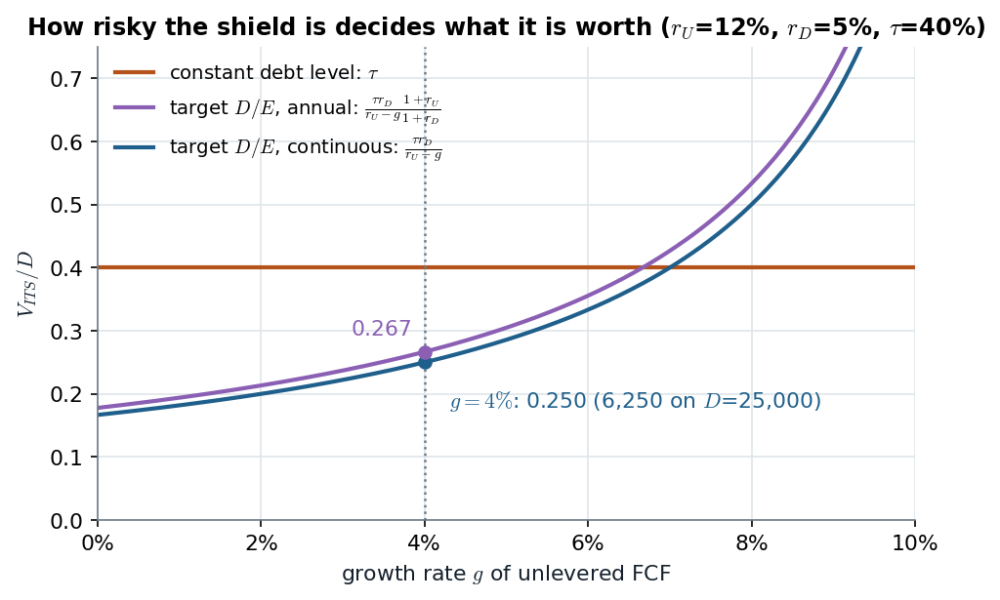
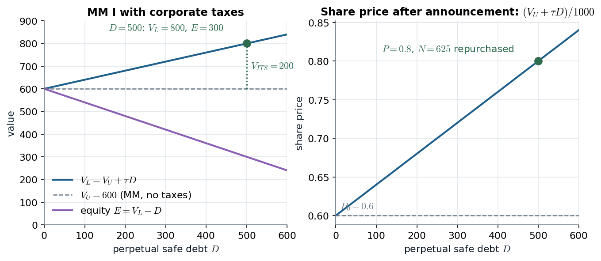

# 2B.1–2B.2 · The interest tax shield and MM I with corporate taxes

> **Claim.** Taxes do not break MM because they are taxes; they break it because **interest is
> deducted before tax and payouts to equity are not**. Each period the levered firm hands its
> investors $\tau r_D D$ more than the unlevered twin, so $V_L=V_U+V_{ITS}$, all of the gain goes to
> **shareholders**, and what $V_{ITS}$ is worth depends entirely on **how risky the future debt
> level is** — a fixed debt gives $\tau D$, a target ratio gives $\tau r_D D/(r_U-g)$.

Prev: [[L03-00-map]] · Next: [[L03-02-after-tax-wacc-apv]] · Map: [[L03-00-map]]

**Notation.**

| Symbol | Meaning | Range |
|---|---|---|
| $\tau$ | corporate (marginal) tax rate | $[0,1)$ |
| $D$, $E$ | market values of debt and equity | $\geq 0$ |
| $r_D$, $r_f$ | expected return on debt; risk-free rate (safe debt: $r_D=r_f$) | $>0$ |
| $r_E$ | expected return on levered equity | |
| $r_U$, $\beta_U$ | expected return and beta of the **unlevered** firm's assets | $r_U>g$ |
| $X$ | operating cash flow (EBIT-like, pre-tax) at $t=1$, growing at $g$ | |
| $V_U$ | value of the hypothetical unlevered firm | |
| $V_{ITS}$, $r_{ITS}$, $\beta_{ITS}$ | PV of interest tax shields; its expected return and beta | |
| $V_L$ | value of the levered firm $=D+E$ | |
| $ITS$ | interest tax shield of one period $=\tau\times$ interest | |

---

## 1 · U — two firms, one tax bill (slides 2–3)

The slide's two firms are Berk's Safeway 2008 (Table 16.2, printed p. 473): same assets, one with
interest expense.

| | Levered | Unlevered |
|---|---|---|
| EBITDA | 2150 | 2150 |
| Depreciation | 300 | 300 |
| EBIT | 1850 | 1850 |
| Interest expense | 350 | 0 |
| Pre-tax income | $1850-350=1500$ | 1850 |
| Taxes (35%) | $0.35\times1500=\mathbf{525}$ | $0.35\times1850=\mathbf{647.5}$ |
| Net income | $1500-525=975$ | $1850-647.5=1202.5$ |
| **Total paid to investors** | $975+350=\mathbf{1325}$ | $\mathbf{1202.5}$ |

The levered firm's net income is lower, but what it pays **to all investors** is higher by

$$1325-1202.5=647.5-525=122.5=350\times0.35 .$$

> **The gain is the tax not paid, and it equals the tax rate times the interest expense.** With
> interest $=r_D\times D$:
> $$ITS=\tau\,r_D\,D \tag{1}$$
> (slide 3; Berk Eq. 16.4, p. 474, "Interest Tax Shield = Corporate Tax Rate × Interest Payments").

---

## 2 · C — the unlevered FCF does not see the shield (slide 4)

Free cash flow (Topic 1, [[../L01/L01-06-cash-flows-fcf|L01 §FCF]]) starts from $EBIT(1-\tau)$,
which taxes EBIT **as if there were no interest**:

| | Levered | Unlevered |
|---|---|---|
| $EBIT(1-35\%)$ | $1850\times0.65=1202.5$ | 1202.5 |
| Depreciation | 300 | 300 |
| **FCF** (no capex, no ΔNWC on the slide) | $1202.5+300=\mathbf{1502.5}$ | $\mathbf{1502.5}$ |

> **FCF is identical across the two firms: it is the *unlevered* FCF, "as if the firm had no
> leverage".** The 122.5 is missing from it by construction, so it must re-enter somewhere else —
> **either in the discount rate (after-tax WACC) or as a separate present value ($V_{ITS}$, APV)**.
> That choice is note [[L03-02-after-tax-wacc-apv]]. Counting it in both is double counting.

---

## 3 · C — the friction is a *differential* treatment (slide 5)

With taxes, capital structure changes the cash flows that reach debt and equity holders. **A tax
that hit interest and dividends alike would leave MM intact** (it would scale every claim by the
same factor). The advantage of debt exists because, in most countries,

- interest payments are **deductible** from taxable income;
- dividends and retained earnings are **taxed** at the corporate level.

Higgins makes the same point from the other side (p. 226): where corporate and personal taxes are
**fully integrated**, "there are no tax benefits to debt financing".

---

## 4 · C — perpetual safe debt: $V_L=V_U+\tau D$ (slides 6–8)

**Setup (slide 6).** The firm generates $X$ at $t=1$, growing at $g$ forever, and keeps a
**constant** level of perpetual **safe** debt $D$, so interest is $r_fD$ each period.

Cash flow paid out each period = equity's after-tax cash flow + debt's interest:

$$(1-\tau)(X-r_fD)+r_fD \tag{2}$$

Expand the first product:

$$(1-\tau)X-(1-\tau)r_fD+r_fD \tag{3}$$

Collect the two $r_fD$ terms, $-(1-\tau)r_fD+r_fD=\tau r_fD$:

$$\underbrace{(1-\tau)X}_{\text{all-equity firm's after-tax cash flow}}+\underbrace{\tau r_fD}_{ITS} \tag{4}$$

**Value the second term (slide 7).** It is constant and as safe as the debt, so it is a perpetuity
at $r_f$:

$$V_{ITS}=\frac{\tau r_fD}{r_f}=\tau D \tag{5}$$

**Value the first term.** It is the unlevered firm's cash flow, risky like the assets, growing at
$g$: a growing perpetuity at $r_U$,

$$V_U=\frac{(1-\tau)X}{r_U-g} \tag{6}$$

Adding (5) and (6), the value of (4):

$$V_L=\frac{(1-\tau)X}{r_U-g}+\tau D \tag{7}$$

> **MM I with corporate taxes (slide 8).** *The value of a levered firm equals that of an
> unlevered firm plus the present value of the interest tax shield:*
> $$\boxed{\;V_L=V_U+V_{ITS}\;} \tag{8}$$
> Same statement: Ross Prop. I with taxes, Eq. (16.3), p. 552; Berk Eq. (16.5), p. 475; Amaro de
> Matos **Proposition 2.1.3**, Eq. (2.7), p. 45 ($V^\tau_l=V^\tau_u+\tau B$).

**Which assumption drives it.** (5) needs the debt to be **permanent and safe** — that is what makes
the shield a riskless perpetuity. Berk's Eq. (16.6)–(16.7) (p. 477) gets $\tau D$ under a weaker
condition: the principal is never repaid (rolled over or defaulted) and new debt is fairly priced,
so $D=PV(\text{future interest})$ and $PV(ITS)=\tau\,PV(\text{future interest})=\tau D$. **Amaro's
version is the cleanest**: in his state-price model taxes are $\tau[V_j-F]^+$ (no tax in default),
so equity + debt $=(1-\tau)V_j+\tau\min\{V_j,F\}$ state by state (p. 45), and summing with state
prices gives $V_u^\tau+\tau B$ **even with risky debt** — the shield is $\tau$ times the market value
of debt whatever that debt pays. That is exactly the $C=0$ case of the trade-off model
([[L03-04-static-trade-off]] eq. (9)).

---

## 5 · Worked — Ross's firms U and L (§16.4, pp. 551–553)

EBIT 1,000 per year forever for both; L has 1,000 of perpetual debt at 8%; $T_C=30\%$; no
depreciation, capex or ΔNWC.

| | U | L |
|---|---|---|
| EBIT | 1,000 | 1,000 |
| Interest $0.08\times1000$ | 0 | 80 |
| Taxable income | 1,000 | 920 |
| Taxes 30% | 300 | 276 |
| Cash flow to shareholders | 700 | $920-276=644$ |
| Cash flow to creditors | 0 | 80 |
| **Total** | **700** | **724** |

$$ITS=80\times0.30=24,\qquad V_{ITS}=\frac{24}{0.08}=300=0.30\times1000\quad\text{(Ross 16.2)}$$

With $R_U=10\%$: $V_U=700/0.10=7{,}000$, and by (8) $V_L=7{,}000+300=7{,}300$, so
$E=7{,}300-1{,}000=6{,}300$.

**MM II for constant debt (Ross 16.4)** — derived in §7 below as (11):

$$R_E=10\%+(10\%-8\%)\times\frac{1000}{6300}\times(1-0.30)=10\%+2\%\times0.15873\times0.70=10\%+0.2222\%=10.22\%$$

$$\text{WACC}=\frac{6300}{7300}(10.2222\%)+\frac{1000}{7300}(8\%)(0.70)=8.8219\%+0.7671\%=9.589\%\approx9.6\%$$

Check with the constant-debt WACC of slide 18 ([[L03-02-after-tax-wacc-apv]] (8)):
$10\%\times(1-0.30\times1000/7300)=10\%\times0.958904=9.589\%$. ✓

> Ross's own reading (p. 553): *"o VPL por real de dívida é de \$0,30. É difícil imaginar por que
> uma empresa não tomaria emprestado o máximo absoluto"* — the 100%-debt puzzle of
> [[L03-03-debt-puzzle-bankruptcy-costs]].

---

## 6 · C — who gets the gain, and why homemade leverage cannot copy it (slide 8)

Slide 8: *"If investors cannot get an equivalent tax break on homemade leverage, they are willing
to pay a premium for levered firms. All the tax benefits from leverage accrue to the shareholders."*

**Homemade leverage fails here** — Higgins's Timid/Bold example (Table 6A.1, p. 225): both earn EBIT
400 on assets 1,000; Bold has 800 of debt at 10%; $\tau=40\%$.

| | Timid | Bold |
|---|---|---|
| EBIT − interest | $400-0=400$ | $400-80=320$ |
| Corporate tax 40% | 160 | 128 |
| Earnings after tax | 240 | 192 |
| Investor's own outlay | 200, borrowing 800 at 10% personally | 200 (all of Bold's equity) |
| Investor's income | $240-80=160$ → **80%** | 192 → **96%** |

The personal loan's 80 of interest is **not** deducted at the 40% corporate rate, so the investor's
replica earns 32 less: $192-160=32=0.40\times80$. **Without taxes the two rows coincide (160% each)
and MM holds; with corporate taxes only the firm can buy the deduction.**

**Why the shareholders get it.** Creditors lend at a fair rate: the debt is worth $D$ and they
receive a fair return on $D$. Whatever is left of $V_L-D=V_U+V_{ITS}-D$ is equity — the whole
$V_{ITS}$ sits on the equity side (§9 makes this a share-price number).

---

## 7 · C — the market-value balance sheet with taxes (slides 9–12)

**Slide 9.** The levered firm's assets are the unlevered assets **plus** the tax-shield asset:

| Assets | Liabilities |
|---|---|
| $V_U$ ($r_U,\beta_U$) | $D$ ($r_D,\beta_D$) |
| $V_{ITS}$ ($r_{ITS},\beta_{ITS}$) | $E$ ($r_E,\beta_E$) |
| $V_L=V_U+V_{ITS}$ | $=D+E$ |

**Slide 10.** A portfolio's return is the value-weighted return of what it holds; both sides hold
the same total, so

$$\frac{D}{D+E}r_D+\frac{E}{D+E}r_E=\frac{V_U}{V_U+V_{ITS}}r_U+\frac{V_{ITS}}{V_U+V_{ITS}}r_{ITS} \tag{9}$$

$$\frac{D}{D+E}\beta_D+\frac{E}{D+E}\beta_E=\frac{V_U}{V_U+V_{ITS}}\beta_U+\frac{V_{ITS}}{V_U+V_{ITS}}\beta_{ITS} \tag{10}$$

Higgins writes (10) in his Ch. 8 appendix footnote 10 (p. 319) from $D+E=V_u+tD$.

**Everything now hinges on $r_{ITS}$ — how risky is the shield?** Two policies.

### 7.1 · Constant debt level: $r_{ITS}=r_D$ (slide 11)

If the firm keeps a constant market value of debt forever, the shield is as risky as the debt, and
(5) with $r_D$ in place of $r_f$ gives $V_{ITS}=\tau Dr_D/r_D=\tau D$. Multiply (9) through by
$V_L=D+E=V_U+\tau D$:

$$Dr_D+Er_E=V_Ur_U+\tau D\,r_D$$

Substitute $V_U=D+E-\tau D$:

$$Dr_D+Er_E=(D+E-\tau D)\,r_U+\tau D\,r_D$$

Move $Dr_D$ to the right and group by $D$:

$$Er_E=Er_U+D(1-\tau)r_U-D(1-\tau)r_D$$

Divide by $E$:

$$\boxed{\;r_E=r_U+\frac{D}{E}(1-\tau)(r_U-r_D)\;}\qquad\text{(constant debt)} \tag{11}$$

— Ross Eq. (16.4), p. 553; Amaro p. 46 ($R^\tau_s=R^u_s+(R^u_s-R)\frac{B}{S^\tau}(1-\tau)$). The
same steps on (10) give $\beta_E=\beta_U+\frac{D}{E}(1-\tau)(\beta_U-\beta_D)$; with safe debt
($\beta_D=0$), **Hamada's** $\beta_E=\beta_U[1+(1-\tau)D/E]$ (Amaro p. 46).

### 7.2 · Constant target $D/E$: $r_{ITS}=r_U$ (slide 12)

If the firm **continuously adjusts** its debt to keep $D/E$ constant, debt rises and falls with the
assets, and so do the shields: $\beta_{ITS}=\beta_U$, $r_{ITS}=r_U$. The right side of (9) becomes
$\frac{V_U}{V_L}r_U+\frac{V_{ITS}}{V_L}r_U=r_U$:

$$\frac{D}{D+E}r_D+\frac{E}{D+E}r_E=r_U \tag{12}$$

Multiply by $D+E$, subtract $Dr_D$, divide by $E$, using $\frac{D+E}{E}=1+\frac{D}{E}$:

$$r_E=\Big(1+\frac{D}{E}\Big)r_U-\frac{D}{E}r_D$$

$$\boxed{\;r_E=r_U+\frac{D}{E}(r_U-r_D)\;}\qquad\text{(target }D/E\text{)} \tag{13}$$

— **the no-tax MM II formula survives unchanged**, with $r_U$ in the role of $r_A$
([[../L02/L02-07-mm2-wacc-cost-of-debt|L02 §MM II]]). Likewise $\beta_U=\frac{D}{V}\beta_D+\frac{E}{V}\beta_E$; with
$\beta_D=0$, $\beta_U=\frac{E}{V}\beta_E$ — Higgins's unlevering formula $\beta_A=\frac{E}{V}\beta_E$
(p. 319), which he obtains from (10) by assuming exactly $\beta_{ITS}=\beta_A$.

> **Slide 12: "This is the usual assumption in valuation."** Unlevering comparables with
> $\beta_U=\frac{E}{V}\beta_E+\frac{D}{V}\beta_D$ (Topic 2A) is *already* the target-ratio
> assumption. Using Hamada's $(1-\tau)$ version silently assumes the opposite policy.

---

## 8 · C — three closed forms for $V_{ITS}$ when FCF grows at $g$ (slide 13)

Let $D$ be today's debt and $r_U>g$. A growing perpetuity paying $c(1+g)^{t-1}$ at $t=1,2,\dots$ is
worth $\sum_{t\ge1}c(1+g)^{t-1}/(1+r)^t=c/(r-g)$.

**(a) Constant debt level.** $ITS_t=\tau r_DD$ every period, discounted at $r_D$:

$$V_{ITS}=\sum_{t\ge1}\frac{\tau r_DD}{(1+r_D)^t}=\frac{\tau r_DD}{r_D}=\tau D \tag{14}$$

**(b) Target $D/E$, continuously adjusted.** Expected debt grows with the firm,
$E_0[D_t]=D(1+g)^t$; $ITS_{t+1}=\tau r_DD_t$ carries asset risk all the way, so it is discounted at
$r_U$:

$$V_{ITS}=\sum_{t\ge1}\frac{\tau r_DD(1+g)^{t-1}}{(1+r_U)^t}=\frac{\tau r_DD}{r_U-g} \tag{15}$$

**(c) Target $D/E$, adjusted once a year.** Debt $D_t$ is set at date $t$ and held for a year, so
$ITS_{t+1}=\tau r_DD_t$ is **known at $t$**: worth $\tau r_DD_t/(1+r_D)$ at $t$. Only $D_t$ itself is
risky (like the assets) between $0$ and $t$:

$$V_{ITS}=\sum_{t\ge0}\frac{1}{(1+r_U)^t}\cdot\frac{\tau r_DD(1+g)^t}{1+r_D}=\frac{\tau r_DD}{1+r_D}\sum_{t\ge0}\Big(\frac{1+g}{1+r_U}\Big)^t$$

The geometric sum is $1/\big(1-\frac{1+g}{1+r_U}\big)=\frac{1+r_U}{r_U-g}$, so

$$\boxed{\;V_{ITS}=\frac{\tau r_DD}{r_U-g}\cdot\frac{1+r_U}{1+r_D}\;} \tag{16}$$

> **Slide 13 prints the second factor as $\frac{1+r_U}{1+r_g}$; derivation (16) shows the
> denominator must be $1+r_D$** — the one period over which the shield is as safe as the debt. The
> same correction applies to the annually adjusted WACC on slide 18. (16) lies between (15) and a
> version discounted wholly at $r_D$, and since $r_U>r_D$, (16) > (15).

**At the slide-28 project's numbers** ($D=25{,}000$, $r_D=5\%$, $\tau=40\%$, $r_U=12\%$, $g=4\%$):

| Policy | Formula | $V_{ITS}$ |
|---|---|---|
| (b) continuous | $\dfrac{0.40\times0.05\times25{,}000}{0.12-0.04}=\dfrac{500}{0.08}$ | **6,250** (the slide-31 value) |
| (c) annual | $6{,}250\times\dfrac{1.12}{1.05}=6{,}250\times1.066667$ | 6,666.67 |
| (a) fixed $D$, no growth of debt | $0.40\times25{,}000$ | 10,000 |

*Figure — $V_{ITS}/D$ under slide 13's three policies at $r_U=12\%$, $r_D=5\%$, $\tau=40\%$: constant debt is flat at $\tau=0.40$; a target ratio gives 0.250 (continuous) and 0.267 (annual) at $g=4\%$. Source: eqs. (14)–(16), slide 13.*

A fixed debt level makes the shield safe, so it is worth more per unit of today's debt than a
target-ratio shield at low growth; at high $g$ the target-ratio shield wins because the debt
behind it grows with the firm. **The policy, not the tax rate, sets the discount rate of the
shield.**

---

## 9 · Worked — the debt-financed repurchase (slides 14–15)

**Data.** Unlevered firm worth 600, 1,000 shares → $P_0=0.6$. It borrows 500 of perpetual safe debt
and uses it to repurchase shares. $\tau=40\%$.

**Value after the announcement**, by (8) and (5):

$$V_L=600+0.40\times500=600+200=800 \tag{17}$$

**Equity**, after the 500 of debt is in place:

$$E=V_L-D=800-500=300 \tag{18}$$

**The repurchase price.** With competition and perfect information the repurchase is a zero-NPV
trade: sellers must be indifferent between selling and keeping, so they sell at the post-
announcement price $P$. With $N$ shares bought,

$$P\times N=500\qquad\text{(the amount raised)} \tag{19}$$

$$P\times(1000-N)=300\qquad\text{(equity after the buyback)} \tag{20}$$

Add (19) and (20): $P\times1000=800$, so

$$P=0.8,\qquad N=\frac{500}{0.8}=625,\qquad 1000-625=375\ \text{shares left},\qquad 0.8\times375=300\ ✓$$

**The gain.** Every original shareholder — those who sell and those who stay — gains
$0.8-0.6=0.2$ per share:

$$0.2\times1000=200=V_{ITS}$$

> **The price jumps at the announcement, not at the repurchase.** Shares are bought back at 0.8,
> already incorporating the shield; that is why the sellers also capture it. Lista R3 Ex. 12 (Berk
> 16.18, printed p. 493) and PS2 Ex. 2(c), 2(e) (`Listas/PS2.pdf`, p. 2) drill exactly this sequence.

*Figure — slide 14's firm: $V_L$ rises with slope $\tau=0.4$ over the no-tax MM line; equity falls by only $(1-\tau)$ per unit of debt; the price after announcement is $(V_U+\tau D)/1000$, 0.8 at $D=500$. Source: eqs. (17)–(20), slides 14–15.*

The purple line is the whole story of who wins: equity falls by $D$ (the claim handed to creditors)
but rises by $\tau D$ (the shield), so each unit of debt-financed buyback costs the remaining
equity only $1-\tau$ of value while paying sellers full price.

---

## 10 · G — personal taxes: Miller (1977) (not in the slides; named, not examinable)

Amaro de Matos §2.2 (pp. 48–54) adds personal tax rates on bond income $\tau_b$ and on equity income
$\tau_s$. Miller's equilibrium in the bond market sets (Eq. 2.11, p. 51)

$$(1-\tau_s)(1-\tau_c)=1-\tau_b(B^*)$$

and the gain from leverage for stockholders (p. 52) is
$G_L=\big[1-\frac{(1-\tau_s)(1-\tau_c)}{1-\tau_b(B^*)}\big]\frac{r_\circ K}{1-\tau_s}$, which (2.11)
makes **zero**: in equilibrium no single firm gains from debt, though aggregate debt is determinate.
With $\tau_s=\tau_b=0$ the gain is back to $\tau_c$ per unit of debt — this note's (5). (Lista R3
Ex. 14, Amaro 2.2.7 #1, printed p. 58, asks for the general $G_L$; not reproduced here.) Higgins's
lower panel of Table 6A.1 (p. 225–226) shows the milder version: a 33% personal tax on **both**
firms' income cuts Bold's edge from 32 to $129-107=22$ but does not remove it.

---

## Links

- Next: [[L03-02-after-tax-wacc-apv]] (where the shield enters the discount rate);
  [[L03-04-static-trade-off]] (the shield when debt is risky and default costly).
- Before: [[../L02/L02-06-mm1-arbitrage-put-call|L02 MM I]] (homemade leverage, the no-tax benchmark),
  [[../L02/L02-07-mm2-wacc-cost-of-debt|L02 MM II]]; FCF definition
  [[../L01/L01-06-cash-flows-fcf|L01 FCF]].
- Rules: [[../../rules/03_benchmark_mm|rules/03]]. Block map: [[../../Map/lectures-index|lectures-index]] (Topic 2B, 2B.1–2B.2).
- Practice: [[../../Listas/lista-r3-mm-taxes-tradeoff|Lista R3]] Ex. 3 (Ross 16.14, p. 578), Ex. 9
  (Grinblatt–Titman 13.15–13.16, p. 494), Ex. 12 (Berk 16.18, p. 493), Ex. 14 (Amaro 2.2.7 #1, p. 58);
  PS2 Ex. 2(a)–(c), (e) ([PS2](../../Listas/PS2.pdf), p. 2); quiz block `tax` of
  [[../../Simulados/quiz-topic2b-taxes-tradeoff-2026-10-24|quiz Topic 2B]].
- Code: [[L03-08-python]] §1.
